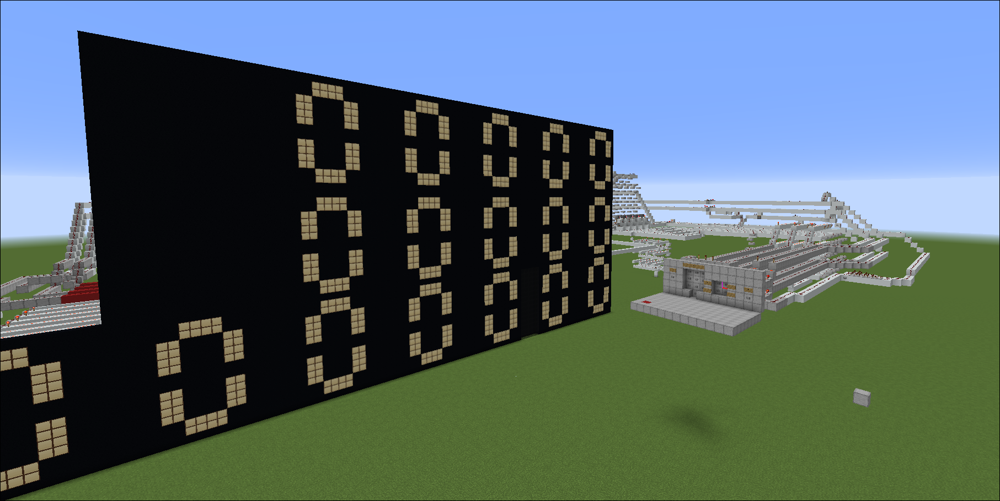

# Redstone Calculator in Minecraft

<p align="center">
  
</p>

A working digital-logic calculator built entirely from redstone in Minecraft (Java 1.16.5). Type numbers on a keypad, see them on 7-segment displays, and let the adder/accumulator do the arithmetic, all with torches, repeaters, pistons, and dust.

---

## Features

- Decimal keypad input (digits 0–9)
- Multi-digit entry: each new digit shifts the previous ones along the displays
- Two-operand entry: first number on the upper display, second on the lower display
- 18-bit signed accumulator (1 sign bit) for arithmetic
- 7-segment decimal readout
- Modular design: every block is a separate, reusable circuit
- clear button to quickly reset the calculator

---

## System Overview

```
 Keypad (0-9)
     │
     ▼
 Decimal → BCD Encoder ──────────────┐
     │                               │
     ▼                               ▼
 Shift Register                18-bit Signed Adder /
 (digit history)                    Accumulator
     │                               │
     ▼                               ▼
 BCD → Decimal Decoder          Result (binary)
     │                               │
     ▼                               ▼
 Decimal → 7-Segment            BCD → Decimal Converter
     │                               │
     ▼                               ▼
 Upper / Lower Displays         Output Displays
```

---

## Modules

### 1. Decimal-to-Binary (BCD) Encoder

Takes the 10 keypad lines (0–9) and encodes the pressed key as a 4-bit BCD value. Codes 10–15 are never produced and are treated as don't-cares.

### 2. BCD-to-Decimal Decoder

Converts a 4-bit BCD value back into one of 10 decimal lines (0–9), so exactly one line is active per digit.

### 3. Decimal-to-7-Segment Driver

Each decimal line (0–9) is wired directly to the segments it must light, so no extra decoding logic is needed. Drives the 7-segment displays.

### 4. BCD-to-Decimal Converter

Converts the accumulator's binary/BCD data into decimal digits for display.

### 5. Shift Register

Stores typed digits. Each new digit pushes the previous digit to the next 7-segment display, so numbers read left to right as you type.

### 6. 18-bit Signed Adder / Accumulator

Built from two 16-bit adders chained together, with 1 sign bit. Convert incoming BCD to 18 bit binary for further calculation.

### 7. Operand Control (Upper / Lower Display)

The first number is typed on the upper display. Pressing arithmetic operation button(+,-,*,/) moves entry to the lower display for the second number.

_(Add more modules here: clock/pulse generator, reset/clear, memory, operator select, etc.)_

---

## How to Use

1. Load the world in Minecraft Java Edition **1.16.5**.
2. Walk to the keypad.
3. Type the first number using the digit buttons. It appears on the upper display.
4. Press the operand-switch button to move to the lower display.
5. Type the second number.
6. Read the result on the output display.
7. Use the reset/clear button to start over.

---

## Requirements

- Minecraft Java Edition 1.16.5 fabric
- [Noredstonedecay](mods/) mod which prevent redstone decay even after 16 block
- A loaded, powered chunk area (keep the whole build within chunk-loading range, or it will stop mid-calculation)
- mod
- [Litematica](mods/) mod which can copy [schematics](schematics/), which can be pasted directly to your build (can be use if you want to extend or modify)

---

## Resource Pack used

- [redstone lamp pack](resourcepacks/) upgraded version of better_redstone_lamps which when off look like black concrete .

---

---

## Concepts Demonstrated

- Encoders and decoders
- BCD representation
- Binary adders and carry chains
- Signed number representation
- Shift registers and sequential logic
- 7-segment display decoding
- Modular digital design

---

## Author

Sanjeev joshi

Note: this project is still in progress and the things provided are the things i already build. After the completition of project i'll upload the world file.
