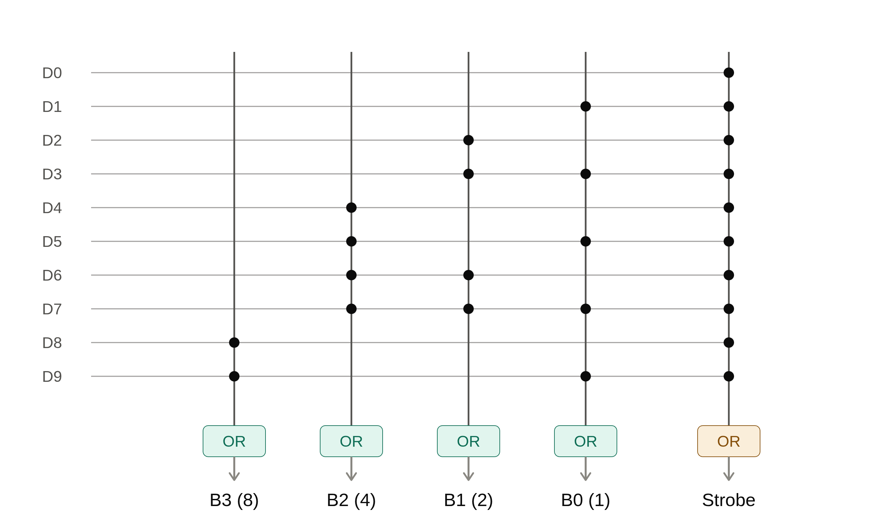
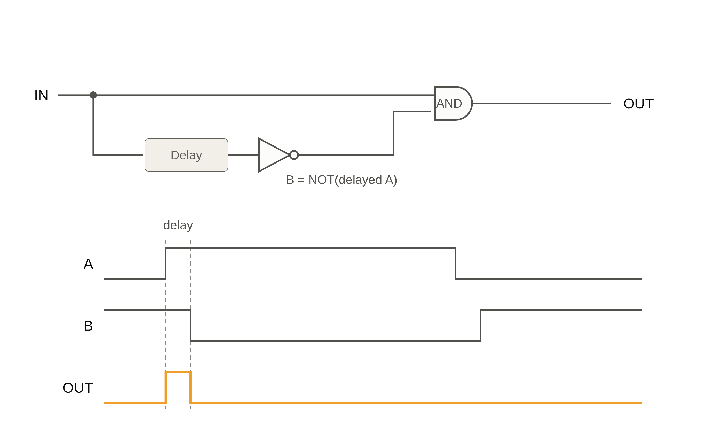
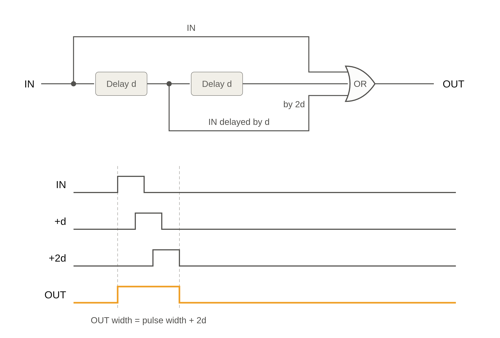
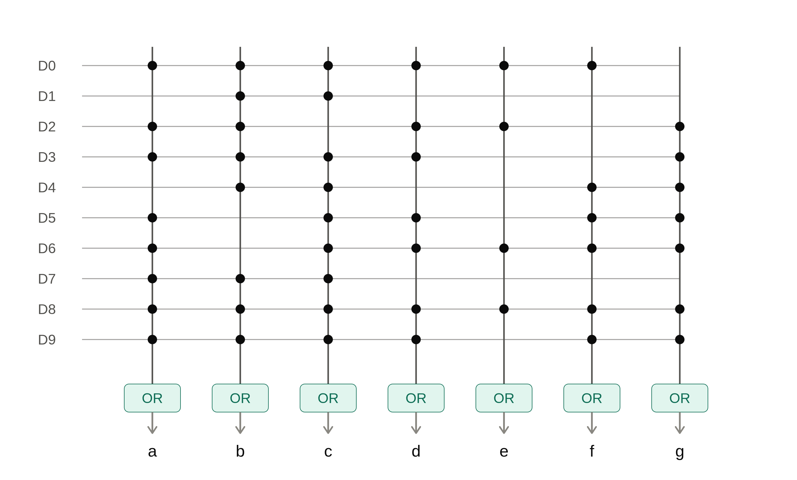
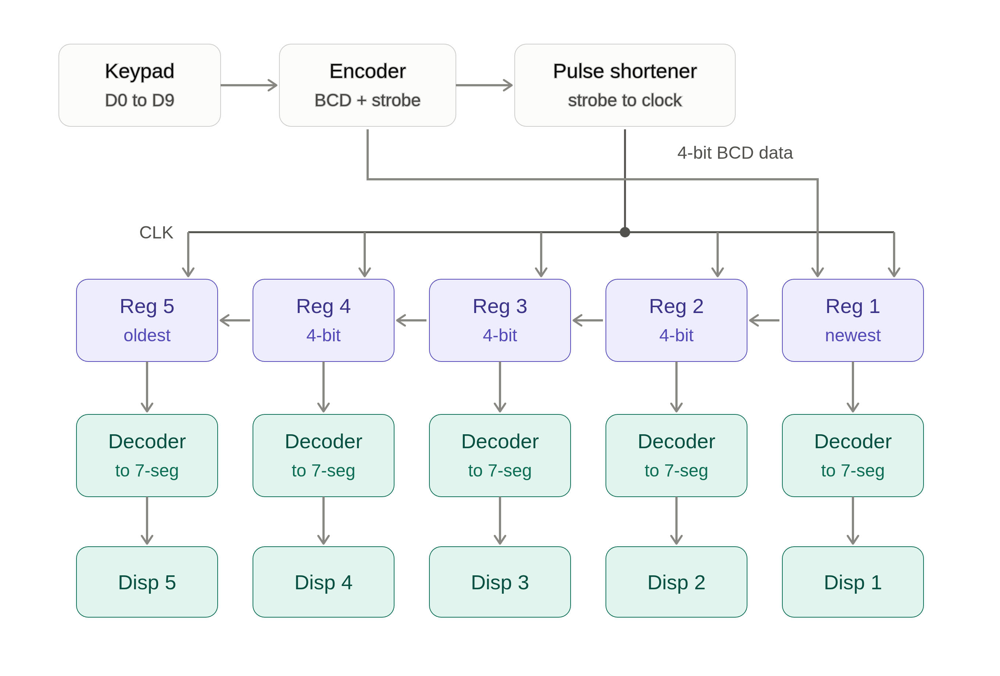
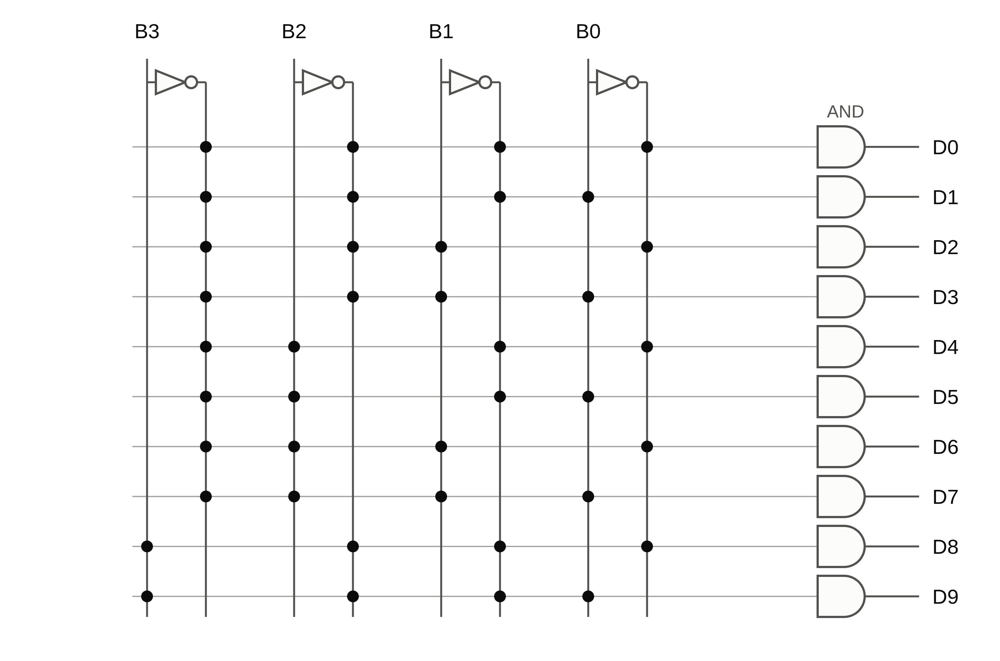
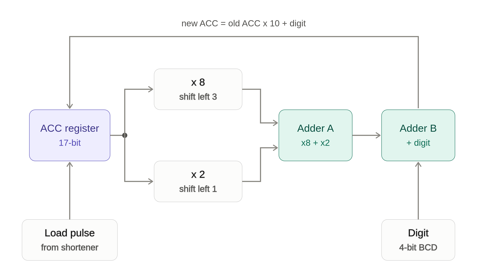
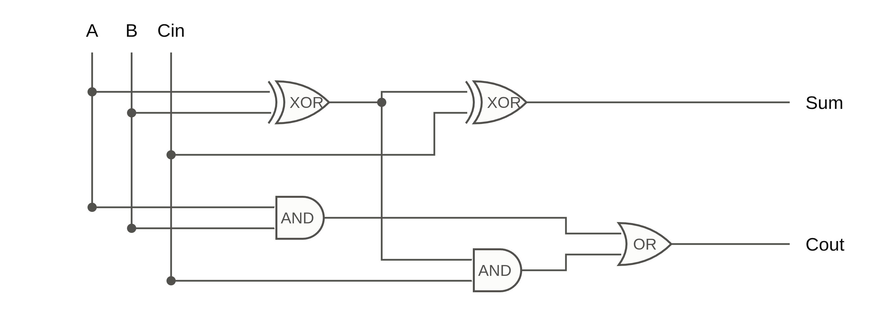
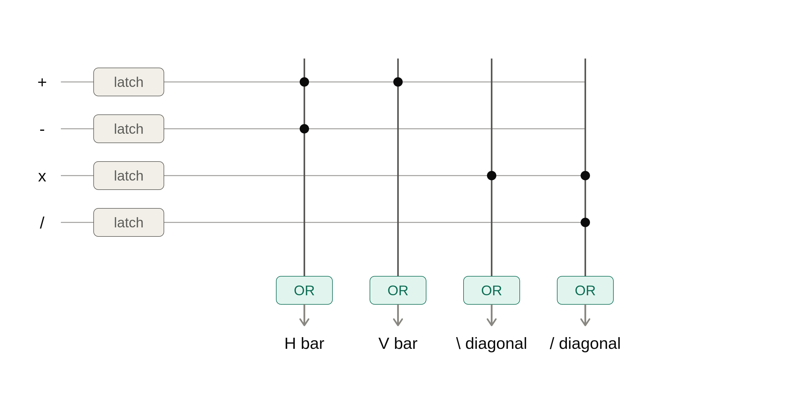
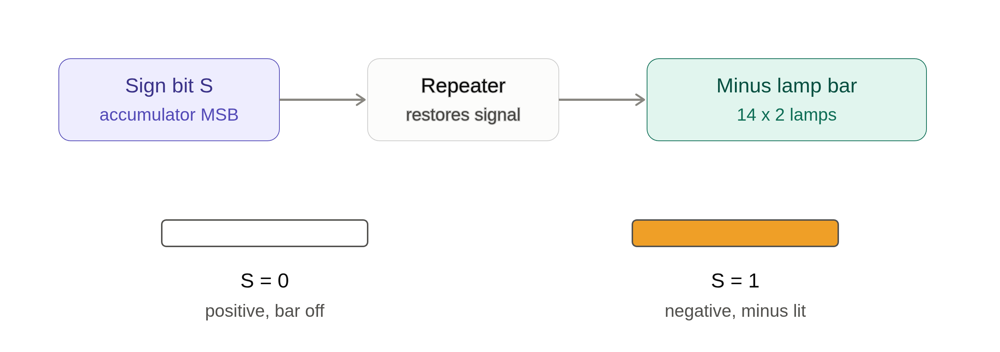

# Circuit Diagrams

Logic schematics for every module of the Redstone Calculator. Click a module title, or the diagram itself, to open the full-size image.

In the redstone build:

| Logic    | Redstone                                       |
| -------- | ---------------------------------------------- |
| OR gate  | dust lines merging                             |
| NOT gate | redstone torch                                 |
| AND gate | two inverted inputs into a torch (NOR of NOTs) |
| Delay    | repeater                                       |

The diagrams show the logic only. Exact repeater ticks, dust routing and torch placement are in the [schematics](../schematics/) and the [screenshots](../screenshots/).

---

## Index

| #   | Module                                                            | Role                              |
| --- | ----------------------------------------------------------------- | --------------------------------- |
| 1   | [Decimal to BCD Converter](#1-decimal-to-bcd-converter)           | Keypad digit to 4-bit code        |
| 2   | [Pulse Shortener](#2-pulse-shortener)                             | One short pulse per key press     |
| 3   | [Pulse Extender](#3-pulse-extender)                               | Stretches a short pulse           |
| 4   | [Decimal to 7-Segment Matrix](#4-decimal-to-7-segment-matrix)     | Lights the right segments         |
| 5   | [5-Digit Shift Register System](#5-5-digit-shift-register-system) | Keeps digit history on 5 displays |
| 6   | [BCD to Decimal Decoder](#6-bcd-to-decimal-decoder)               | 4-bit code back to 10 lines       |
| 7   | [Accumulator and Full Adder](#7-accumulator-and-full-adder)       | Does the arithmetic               |
| 8   | [Operator Display](#8-operator-display)                           | Shows + - x /                     |
| 9   | [Sign Bit Display](#9-sign-bit-display)                           | Shows the minus sign              |

### How the modules connect

```
Keypad -> BCD encoder -> strobe -> pulse shortener -> clock
                      \-> 4-bit digit -> shift register -> decoders -> displays
                      \-> 4-bit digit -> accumulator (ACC x 10 + digit) -> sign bit display
Operator keys -> operator display (symbol stays on screen)
```

---

## 1. [Decimal to BCD Converter](decimal_to_bcd_encoder_matrix.png)

Turns a key press (D0 to D9) into a 4-bit BCD code plus a strobe. Each output bit is an OR of the digit lines that have that bit set.

```
B0 = D1 + D3 + D5 + D7 + D9
B1 = D2 + D3 + D6 + D7
B2 = D4 + D5 + D6 + D7
B3 = D8 + D9
STROBE = D0 + D1 + ... + D9
```

<a href="decimal_to_bcd_encoder_matrix.png"></a>

Build: [screenshot](../screenshots/decimal_input_to_binary.png) | [schematic](../schematics/Decimal_input_to_Binary_converter.litematic)

---

## 2. [Pulse Shortener](pulse_shortener_schematic_timing.png)

Turns a held key press into one short pulse, so the circuit loads only once per press.

```
OUT = IN AND NOT(IN delayed)
```

<a href="pulse_shortener_schematic_timing.png"></a>

Build: [screenshot](../screenshots/pulse_shortner.png) | [schematic](../schematics/Pulse_shortner.litematic)

---

## 3. [Pulse Extender](pulse_extender_schematic_timing.png)

Does the opposite of the shortener. It ORs the signal with delayed copies of itself, so a short pulse becomes longer.

```
OUT = IN + IN(delay d) + IN(delay 2d)      width = pulse width + 2d
```

The input pulse must be at least as long as the delay `d`, or the output splits into separate pulses.

<a href="pulse_extender_schematic_timing.png"></a>

Build: [screenshot](../screenshots/pulse_entender.png)

---

## 4. [Decimal to 7-Segment Matrix](decimal_to_7segment_matrix.png)

Wires each digit line straight to the segments it must light. Each dot is a tap onto that segment's OR line.

```
a = D0 + D2 + D3 + D5 + D6 + D7 + D8 + D9
b = D0 + D1 + D2 + D3 + D4 + D7 + D8 + D9
c = D0 + D1 + D3 + D4 + D5 + D6 + D7 + D8 + D9
d = D0 + D2 + D3 + D5 + D6 + D8 + D9
e = D0 + D2 + D6 + D8
f = D0 + D4 + D5 + D6 + D8 + D9
g = D2 + D3 + D4 + D5 + D6 + D8 + D9
```

<a href="decimal_to_7segment_matrix.png"></a>

Build: [screenshot](../screenshots/decimal_input_7_seg_display.png) | [schematic](../schematics/Decimal_input_7_segment_display.litematic)

---

## 5. [5-Digit Shift Register System](shift_register_5x_system.png)

Keypad, encoder, pulse shortener, five registers, decoders and displays. Each new digit pushes the older ones one display to the left, so typing 1, 2, 3 shows `1 2 3`.

<a href="shift_register_5x_system.png"></a>

Build: [screenshot](../screenshots/main.png) | [schematic](../schematics/Decimal_Input_7_seg_with_shift_registor%285x%29.litematic)

---

## 6. [BCD to Decimal Decoder](bcd_to_decimal_decoder_gates.png)

Turns a 4-bit BCD value back into one of ten lines. Each output is an AND of the four bits, using the true or inverted form of each. Torches make the inverted bits.

```
D0 = B3' B2' B1' B0'
D5 = B3' B2  B1' B0
D9 = B3  B2' B1' B0
(and so on for D1 to D8)
```

<a href="bcd_to_decimal_decoder_gates.png"></a>

Build: [screenshot](../screenshots/BCD_to_decimal_converter.png)

---

## 7. [Accumulator and Full Adder](accumulator_block_diagram.png)

Builds the full number as digits are typed:

```
new ACC = old ACC x 10 + digit
```

Multiplying by 10 uses `x10 = x8 + x2`, which is two bit shifts and two adders. A load pulse latches the result back into the register.

<a href="accumulator_block_diagram.png"></a>

Each adder is a ripple-carry chain of the one-bit [full adder cell](full_adder_cell_gates.png), repeated for every bit:

```
Sum  = A XOR B XOR Cin
Cout = (A AND B) OR (Cin AND (A XOR B))
```

<a href="full_adder_cell_gates.png"></a>

Build: [screenshot](../screenshots/accumulator.png) | [schematic](../schematics/17_bit_accumulator.litematic)

---

## 8. [Operator Display](operator_display_matrix.png)

Shows the chosen operator (+, -, x, /) on a lamp display. Each operator key is latched and ORed onto four lamp bars.

```
H bar      = + or -
V bar      = +
\ diagonal = x
/ diagonal = x or /
```

<a href="operator_display_matrix.png"></a>

Build: [screenshot](../screenshots/Operator_Display.png) | [schematic](../schematics/Operator_Display.litematic)

---

## 9. [Sign Bit Display](sign_bit_display_logic.png)

The accumulator's sign bit drives a bar of lamps through a repeater. The bar is off for a positive number and lit as a minus sign for a negative one.

<a href="sign_bit_display_logic.png"></a>

Build: [screenshot](../screenshots/sign_bit_display.png) | [schematic](../schematics/sign_bit_display.litematic)
